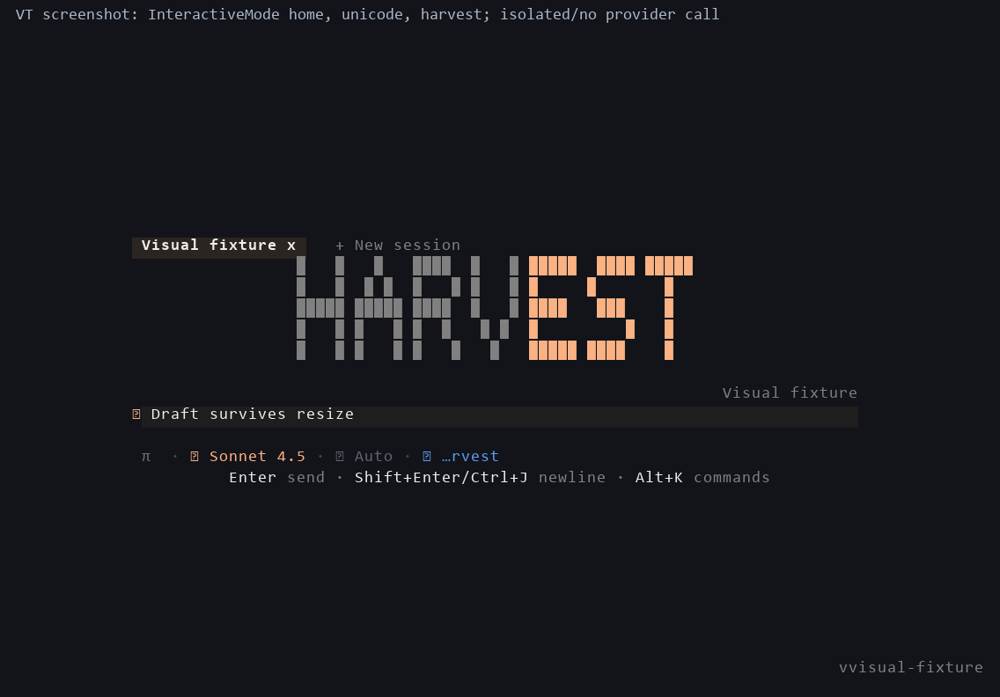
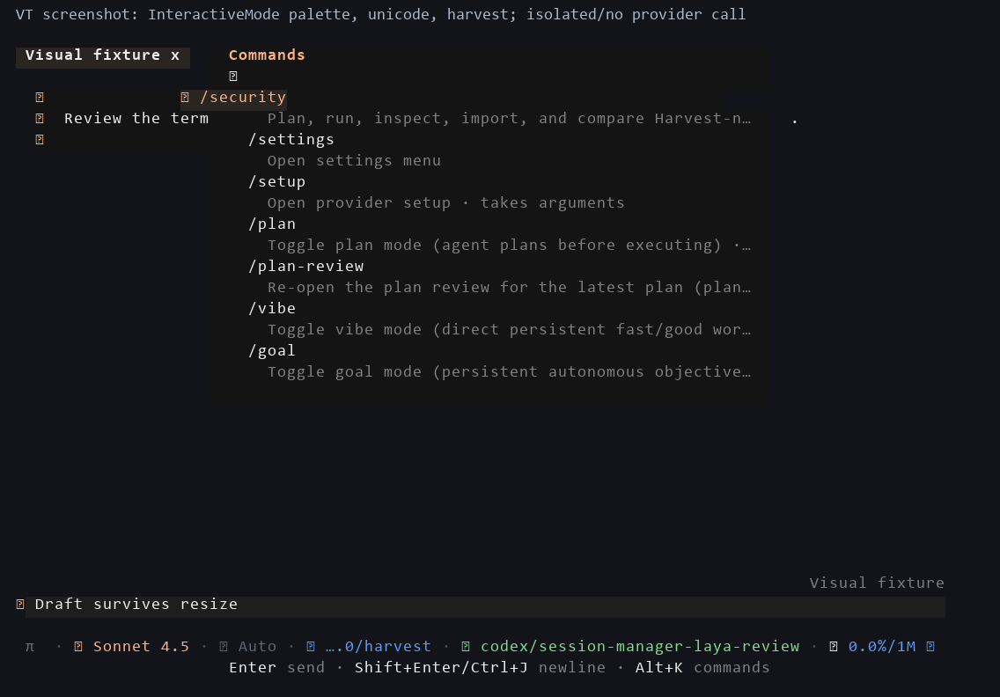
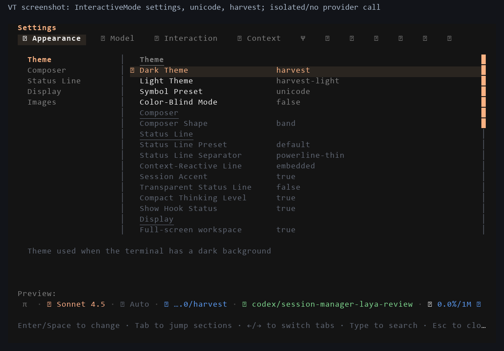
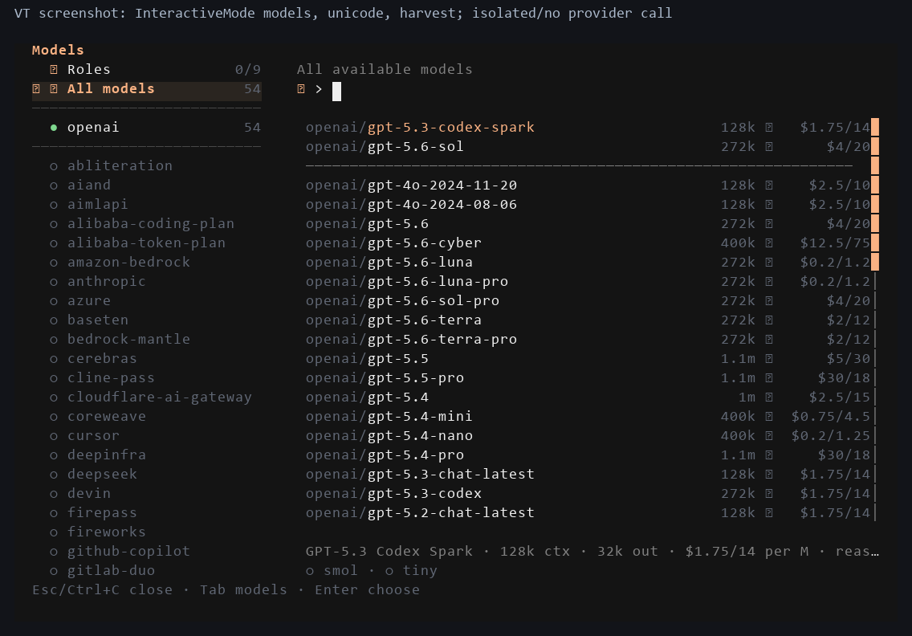

# Harvest

**An AI coding agent for the terminal, with code intelligence, debugging, and collaboration built in.**

Harvest brings file editing, shell execution, language servers, persistent evaluation
kernels, session management, and coordinated subagents into one workspace. It
supports multiple model providers and runs on macOS, Linux, and Windows.

[Getting started](#getting-started) · [Documentation](#documentation) ·
[Contributing](CONTRIBUTING.md) · [Changelog](packages/coding-agent/CHANGELOG.md) ·
[MIT License](LICENSE)



## Interface tour

These are genuine virtual-terminal captures of Harvest's mounted application
components, recorded on October 8, 2026, with the Harvest dark theme. The capture
harness uses isolated sessions and fixture data without live provider requests.
They show that development checkpoint; later versions may look different.
See the [capture provenance and limitations](docs/tui-visual-implementation-evidence-2026-10-08/README.md).

### Command palette

Browse commands for setup, settings, planning, and session controls.



### Settings

Configure appearance, model behavior, interaction, and context from the terminal.



### Model selection

Browse configured providers and assign models to different roles. Model names,
availability, and prices in this historical capture are illustrative.



## Capabilities

| Area                    | What Harvest provides                                                                                 |
| ----------------------- | ----------------------------------------------------------------------------------------------------- |
| Files and search        | Read and write files, search repositories, apply hash-anchored edits, and preview structural changes. |
| Code intelligence       | LSP diagnostics, symbols, navigation, code actions, and coordinated renames.                          |
| Execution and debugging | Persistent shell sessions, Python and JavaScript evaluation kernels, and DAP debugging.               |
| Agent coordination      | Parallel subagents, isolated worktrees, typed results, an Agent Hub, and an optional advisor role.    |
| Sessions                | Tabs, resume, branching, timelines, export, and background work.                                      |
| Models                  | Multiple providers, role-based routing, custom endpoints, fallback chains, and credential selection.  |
| Memory and skills       | Project memory, reusable skills, revision history, evaluation, promotion, and rollback.               |
| Collaboration           | Shared terminal sessions, a browser guest client, RPC, ACP, and an embeddable SDK.                    |
| Native operations       | Rust-backed search, shell utilities, syntax analysis, terminal processes, and image handling.         |

Some tools require an enabled setting, an optional backend, provider credentials,
or a compatible terminal. The linked references describe their configuration.

## Getting started

### Install a release

On macOS or Linux, use the repository's installer:

```sh
curl -fsSL https://raw.githubusercontent.com/Sanidhya14321/harvest/main/scripts/install.sh | sh
```

The installer selects the platform build, verifies its SHA-256 checksum, and
checks that it starts before replacing an existing installation. It creates the
`harvest` command in `~/.local/bin`; ensure that directory is on your `PATH`.
Re-run the installer to update.

For Windows or manual installation, download the matching platform executable from
[GitHub Releases](https://github.com/Sanidhya14321/harvest/releases), verify it
against the release's `SHA256SUMS.txt`, and save it locally. You can rename the
executable to `harvest.exe` on Windows or `harvest` on macOS/Linux and place it
in a directory on your `PATH`. On macOS/Linux, make it executable with
`chmod +x harvest`. Keep the release's license and third-party notices.

On Alpine Linux, install `libstdc++` and `libgcc` before running the musl build.

### Run from source

Install [Git](https://git-scm.com/), [Bun](https://bun.sh/), and the Rust toolchain
specified in [rust-toolchain.toml](rust-toolchain.toml). Native compilation also
requires your platform's C/C++ build tools; on macOS, install the Xcode Command
Line Tools with `xcode-select --install`.

```sh
git clone https://github.com/Sanidhya14321/harvest.git
cd harvest
bun setup
bun dev
```

`bun setup` installs workspace dependencies and builds the native addon. A
non-interactive startup check is `bun dev -- --version`.

Nix users can enter the development environment with `nix develop` before
running the setup commands.

### Start a session

```sh
harvest                                    # Open the terminal workspace
harvest "Summarize this repository"         # Start with a prompt
harvest -p "List the TypeScript entrypoints" # Answer once and exit
harvest --continue                         # Continue the previous session
harvest --resume                           # Choose a saved session
```

For a source checkout, use `bun dev --` in place of `harvest` when passing CLI
arguments. Use `/login` to configure a supported provider account and `/model`
to choose a model. Authentication methods vary by provider; see
[providers](docs/providers.md) and [model configuration](docs/models.md).

Attach files and images with `@path`, or pipe text through standard input:

```sh
harvest @README.md "Suggest documentation improvements"
git diff | harvest -p "Review these changes"
```

## Working in Harvest

### Workspace and sessions

The workspace includes session tabs, a prompt composer, transcript navigation,
and a responsive sidebar. The sidebar shows session context, model usage,
language-server and MCP status, tasks, agents, and workspace changes.

| Action                    | Control                            |
| ------------------------- | ---------------------------------- |
| Browse commands           | `Alt+K` or `/commands`             |
| Toggle the sidebar        | `Alt+Shift+B` or `/sidebar`        |
| Supervise subagents       | `Alt+A`                            |
| Select a model            | `/model` or `/switch`              |
| Browse sessions           | `/sessions`                        |
| Branch or inspect history | `/branch`, `/tree`, or `/timeline` |
| Review changes            | `/review`                          |
| Share a session           | `/collab`                          |
| Inspect settings          | `/settings`                        |

Keybindings can be remapped. Harvest includes dark and light themes, mouse
navigation, and compact layouts for smaller terminals. Session branching keeps
the earlier path available, and saved sessions can be resumed or exported.
See [session operations](docs/session-operations-export-share-fork-resume.md)
and [settings](docs/settings.md).

### Code, tools, and review

Harvest's tools cover files, repository search, shell execution, structural
editing, language servers, debugging, and agent coordination. Hash-anchored
edits reject stale content; structural edits can be previewed before acceptance.
Language-server integration supports diagnostics and coordinated renames.

Persistent Python and JavaScript kernels can call tools and return structured
results or charts. Debug sessions use DAP adapters such as LLDB, Delve, and
debugpy. Browser and desktop automation are available through the evaluation
prelude when their backends are configured.

`/review` supports a base branch, uncommitted changes, or a selected commit.
`harvest commit` analyzes changes for dependency-ordered commits, while worktree
commands support isolated work. Subagents return typed results and can be
supervised through the Agent Hub.

See the [tool reference](docs/tools/), [LSP configuration](docs/lsp-config.md),
and [advisor configuration](docs/advisor-watchdog.md).

### Providers, search, and memory

Model roles include `default`, `smol`, `slow`, `plan`, `commit`, `vision`, `task`,
`advisor`, and `tiny`. Configure custom providers in
`~/.harvest/agent/models.yml`, choose fallback chains, or scope models to a
project. Local OpenAI-compatible servers are supported alongside hosted APIs
and provider-specific sign-in methods.

Web search supports multiple backends, and URL reading handles documentation,
code hosts, research papers, and other structured sources. Available backends
and authentication requirements are described in the [tool reference](docs/tools/).

Memory tools retain and recall project knowledge across sessions. Managed skills
support revisions, evaluation, promotion, and rollback. Select a memory backend
with `memory.backend`; see [memory](docs/memory.md) and [skills](docs/skills.md).

### Collaboration and integrations

`/collab` shares a session through a relay with terminal and browser guests.
Use `harvest join` to join from another terminal, or `/collab view` for a
read-only view.

For programmatic access, `harvest --mode rpc` exchanges NDJSON over standard
input and output, `harvest acp` integrates with editors through the Agent Client
Protocol, and the SDK embeds sessions in an application.

See [collaboration](docs/collab.md), [RPC](docs/rpc.md), and [SDK](docs/sdk.md).

### Configuration and extensions

Harvest discovers project instructions, skills, and MCP configuration from
supported development tools. User-level external sources are opt-in through
`enabledProviders`. Extensions can add tools, commands, keybindings, hooks,
and terminal components; `/reload-plugins` reloads installed extensions.

See [hooks](docs/hooks.md), [MCP configuration](docs/mcp-config.md),
[marketplaces](docs/marketplace.md), and [custom tools](docs/custom-tools.md).

Generate shell completions with:

```sh
harvest completions bash
harvest completions zsh
harvest completions fish
```

## Documentation

| Reference                                                                                | Contents                                                                  |
| ---------------------------------------------------------------------------------------- | ------------------------------------------------------------------------- |
| [Development guide](packages/coding-agent/DEVELOPMENT.md)                                | Application structure, subsystem documentation, and development commands. |
| [Tool reference](docs/tools/)                                                            | Tool arguments, behavior, and configuration.                              |
| [Providers](docs/providers.md) / [models](docs/models.md)                                | Authentication, endpoints, model roles, and routing.                      |
| [Settings](docs/settings.md)                                                             | Application and workspace configuration.                                  |
| [Memory](docs/memory.md) / [skills](docs/skills.md)                                      | Persistent knowledge and reusable workflows.                              |
| [Native architecture](docs/natives-architecture.md)                                      | Rust-backed operations and native integration.                            |
| [Rust runtime](rust-agent/README.md) / [migration status](docs/rust-migration/README.md) | Experimental runtime and remaining compatibility work.                    |
| [Contribution guide](CONTRIBUTING.md)                                                    | Reporting problems, development, review, and licensing.                   |

The interactive application uses the TypeScript/Bun workspace and Rust native
components. The experimental Rust application is under active development and
is not yet a feature-compatible replacement; consult its migration status
before choosing it for a workflow.

## Development

Run `bun setup` after cloning. Rebuild native components with
`bun run build:native` after changing Rust crates or the native binding package.

| Check                                   | Command                                           |
| --------------------------------------- | ------------------------------------------------- |
| Application lint, formatting, and types | `bun --cwd=packages/coding-agent run check`       |
| Application types only                  | `bun --cwd=packages/coding-agent run check:types` |
| A focused TypeScript test               | `bun test <path-to-test>`                         |
| A TypeScript CI suite                   | `bun scripts/ci-test-ts.ts <suite>`               |
| Rust tests and doctests                 | `bun run test:rs`                                 |
| CLI startup                             | `bun dev -- --version`                            |

Use the repository's check commands for type checking. Full TypeScript suites
use the CI runner rather than an unscoped root test invocation. When changing
catalog rules or model sources, regenerate their outputs with
`bun run gen:compat` or `bun run gen:models`; do not edit generated JSON by hand.

## Repository layout

| Path                                            | Purpose                                                       |
| ----------------------------------------------- | ------------------------------------------------------------- |
| [packages/coding-agent](packages/coding-agent/) | Terminal application, CLI, and SDK.                           |
| [packages/agent](packages/agent/)               | Agent execution loop and state management.                    |
| [packages/ai](packages/ai/)                     | Multi-provider client and streaming.                          |
| [packages/catalog](packages/catalog/)           | Model catalog, provider descriptors, and compatibility rules. |
| [packages/tui](packages/tui/)                   | Terminal rendering and interface components.                  |
| [packages/natives](packages/natives/)           | Native bindings for search, shell, images, and text.          |
| [packages/stats](packages/stats/)               | Local observability dashboard.                                |
| [packages/collab-web](packages/collab-web/)     | Browser collaboration client and local relay.                 |
| [packages](packages/)                           | Supporting libraries, memory backends, and benchmark tools.   |
| [crates](crates/)                               | Rust runtime, native operations, and vendored components.     |
| [rust-agent](rust-agent/)                       | Experimental Rust CLI application.                            |
| [docs](docs/)                                   | Feature references, architecture, and verification records.   |

## Contributing

Harvest welcomes bug reports, documentation improvements, tests, and focused
code contributions. Read [CONTRIBUTING.md](CONTRIBUTING.md) for setup, scope,
verification, and review requirements before submitting a pull request.

Harvest is built and maintained by the **Harvest contributors**. We recognize
Sanidhya Vats, Naman, and Pulkit for their recorded contributions, alongside
everyone who contributes code, documentation, testing, bug reports, and design
feedback. See the
[contributors](https://github.com/Sanidhya14321/harvest/graphs/contributors)
and [project history](https://github.com/Sanidhya14321/harvest/commits/main/)
for recorded contributions.

## License

Copyright (c) 2026 Sanidhya Vats, Naman, and Pulkit.

Harvest is available under the [MIT License](LICENSE), which permits use,
modification, and redistribution subject to its terms, including preservation
of the copyright and permission notices. The software is provided without
warranty.

Inherited copyright and permission notices are retained in
[THIRD-PARTY-NOTICES.txt](THIRD-PARTY-NOTICES.txt). Third-party and vendored
components remain subject to their respective licenses and component-local
license files.
